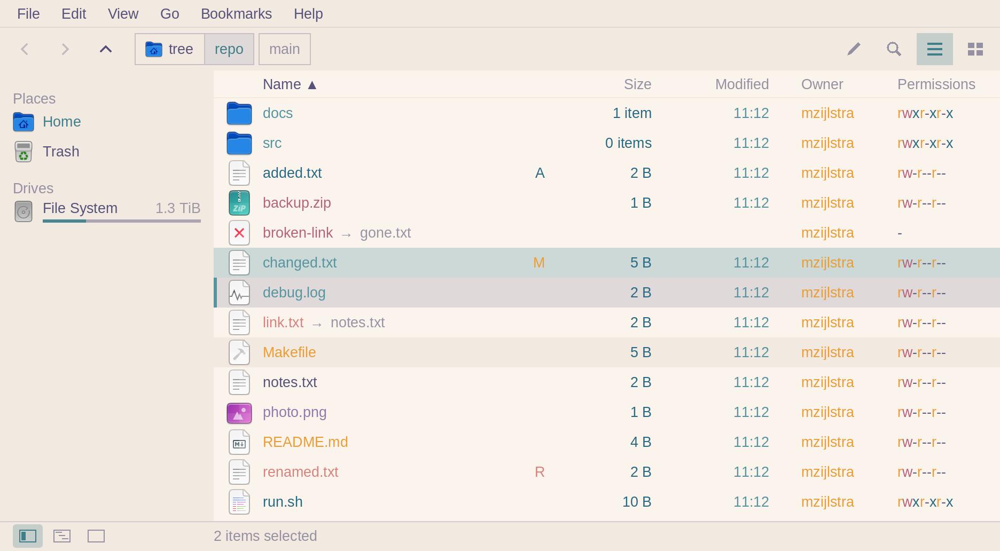
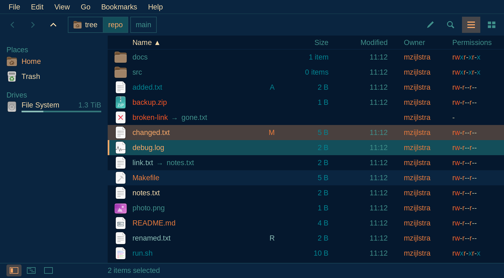

# ofx

A keyboard-first file explorer for Omarchy: one folder at a time as a list, in the current
theme's colours and icons. C with arenas, Clay for layout, raylib on native Wayland. It idles at
about 0% CPU: it draws only when something changes.


<p align="center"><em>Tokyo Night, Omarchy's default theme</em></p>

| Rose Pine (light) | Retro 82 |
|:---:|:---:|
|  |  |

ofx follows the theme Omarchy has set, and changes with it while it runs.

## Build and run

```sh
make            # build/ofx, debug with ASan and UBSan
make release    # build/release/ofx
make test       # unit tests for fs/ and ui/
make test-fm1   # ofx-fm1 end to end, on a private D-Bus session
make install    # ofx, ofx-clean and ofx-fm1 into ~/.local/bin, the cleanup's timer into ~/.config/systemd/user
ofx [--select] [PATH]   # the current folder by default; on a file (or with --select), its folder, it selected
```

Needs a C11 compiler, `wayland-scanner`, and the pkg-config packages wayland-client,
wayland-cursor, wayland-egl, xkbcommon, fontconfig and freetype2, and libjpeg-turbo, libwebp,
libpng, giflib and zlib for the previews, and libsystemd (sd-bus) for ofx-fm1. raylib, Clay and
nanosvg are vendored.

`ofx-fm1` answers `org.freedesktop.FileManager1` on the session bus, so a browser's "Show in
folder" opens ofx (the file selected) instead of Nemo. The bus starts it when asked (`make install`
puts its service file in `~/.local/share/dbus-1/services`), and it exits when idle.

## Use

| Key | |
|---|---|
| Up/Down, `j`/`k` | move; past the first or the last, round to the other end (the icon view: Left/Right round the ends, Up/Down in the column) |
| PgUp/PgDn | a page |
| Home/End, `g`/`G` | first, last |
| Shift+Enter | Open With Other Application: the apps for the selected files (or the cursor's); on a path button it opens a background tab, elsewhere it is Enter |
| Enter | open: a folder is entered, a file goes to `gio open` (Nemo's way: the type from its name; a terminal app such as nvim in a terminal); an empty file, which gio can't type, to the default app for its name's type (`gio launch`); several selected files, each default app once with all of its files (folders among them stay) |
| Backspace | up to the parent, the folder you left selected |
| Alt+Left, Alt+Right | back and forward |
| Alt+Up | up to the parent |
| In any text field (rename, location, find, search, Open With, Edit Bookmarks, Keyboard Shortcuts) | Left/Right, Home/End move; Shift selects; Ctrl+Left/Right a word, Ctrl+Shift+Left/Right select a word; Backspace/Delete, Ctrl+Backspace/Ctrl+Delete a word; Ctrl+A all of it; Ctrl+C, X, V the clipboard (outside a field Ctrl+Left is the sidebar, Ctrl+Right the location line) |
| Ctrl+L, Ctrl+Right | type a location: all of it selected, so typing replaces it; `~` is home, a relative path starts here; a file's path opens its folder with the file selected |
| Ctrl+K, Ctrl+Up | in a search, the keys back to its field (the one they were in last), and from there to the path buttons; elsewhere straight to the path buttons: Left/Right (`h`/`l`), Home/End move, Enter goes there, Shift+Enter opens it in a background tab, Esc back to the list |
| `/`, Ctrl+F | find, in a bar over the job rows: type to jump (the bar counts the matches: "2 of 5"; its field edits as the rename line does: a caret, Shift to select, Ctrl+A its text, Ctrl+C, X, V), Up/Down or its chevrons the previous and next match, Enter keeps (the bar stays, the keys go back to the list), Esc closes it and goes back, its × closes it; then `n`/`N` again. Alt+C match case, Alt+W whole words, Alt+R a regular expression (the toggles in the bar too; kept for the next find) |
| Ctrl+Shift+F, the top bar's magnifier, Go → Search… | search below the folder shown, in a tab of its own: type a name, or part of one (`*` and `?` make it a wildcard over the whole name: `*.ts`); 150 ms after the last key the results come in, each with its folder after it, dim. The field edits as the rename line does (a caret, Shift to select, Ctrl+A its text, Ctrl+C, Ctrl+X, Ctrl+V the clipboard's first line). Enter, Esc or Down give the keys to the results; Ctrl+Shift+F or a click on the field gives them back. Find's Alt+C, Alt+W and Alt+R apply. Left out, and named in the status line: `.git`, `node_modules`, hidden files (as Show Hidden Files), other drives, links to folders; at most 10,000 results. Enter opens a result, a folder in the same tab (Back is the search again); Ctrl+Enter (Open Containing Folder, in a result's menu too) goes to its folder with it selected; Alt+Up goes to the folder searched. What the list does works on results, each in its own folder (rename, trash, delete, Make Link, Duplicate); a result whose file goes leaves the list, and an undo brings it back; nothing is watched, so Ctrl+R searches again. A terminal or a new window opens on the folder searched; Paste, New Folder and Add Bookmark don't (a search isn't a folder). Search in Folder… in a folder's right-click menu (in the list, the sidebar, the path) searches below it |
| In a search, Alt+I or "In files" | search inside files too: a "Containing" field under the name's, with its own Alt+C, Alt+W, Alt+R (a regular expression matches within a line). The name field narrows which files are read (empty: all of them). Each result shows its first matching line's number and the line around the match, lit, and "+N" for the other lines that match. Plain text only: a file with a NUL in its first 8 KB counts as binary, files over 16 MB and links to files aren't read; the status line says how many files it read and what it left out |
| Ctrl+Shift+F… then Ctrl+Shift+Enter, or "Open at Line" in a result's menu | a result found inside files in your editor at its line and column: Omarchy's default editor (`omarchy default editor`), else `$EDITOR`'s program, else nvim; a terminal editor in a terminal. Built in: nvim, vim, helix, hx, micro, nano, kak, emacs, code, codium, cursor, zeditor, zed, sublime_text, subl. Others, or your own way of opening (a script, say, that hands the file to an nvim already running), go in ofx.conf (Edit → Preferences…), one a line: `editor = name yes\|no command…` (the older `~/.config/ofx/editors`, the same lines without `editor =`, is still read after them), yes for a terminal editor, the command's words with `{file}`, `{line}` and `{col}` (characters) filled in, "quotes" around a word with spaces, `~/` the home folder. One by a built-in's name replaces it; `$EDITOR`'s flags aren't kept (give that editor a recipe) |
| `.`, Ctrl+H | hidden files on and off |
| Ctrl+P, Ctrl+G | View → Show Permissions, View → Show Group |
| `s`, `S` | sort by the next column (name, size, modified), reverse |
| Tab, Ctrl+Left | the keys to the sidebar (a hidden one shows as places); Tab again back; in the tree, Left/Right (`h`/`l`) close and open a folder (or move up and down a level), Enter goes there |
| F9, Ctrl+S | the sidebar's next mode: places, tree, hidden |
| Ctrl+1, Ctrl+2 | the files as the list, as icons (also the two buttons at the right of the top bar; remembered) |
| Ctrl+=, Ctrl+-, Ctrl+0 | in the icon view, the icons a size bigger, smaller, back to 48 px (also Ctrl+wheel, and the slider at the right of the bottom bar; remembered) |
| `t`, Alt+Enter | a terminal in this folder (`xdg-terminal-exec --dir`) |
| Ctrl+I | Properties: size or a folder's contents (counted all the way down), location, drive, dates, owner, and the permissions as a grid: arrows (`h`/`j`/`k`/`l`) move, Space or Enter changes one at once (Ctrl+Z puts it back), Esc closes |
| `~`, Alt+Home | home |
| Alt+End | the trash view |
| Ctrl+D | bookmark the folder shown (in the GTK bookmarks file, shared with Nemo); the Bookmarks menu (Alt+B) lists the first 8 and goes there |
| Ctrl+B | Edit Bookmarks: every line of the file; Up/Down (`k`/`j`) move, Enter goes there, Delete removes, F2 renames, Alt+Up/Alt+Down move it, Esc closes |
| Space, Ctrl+A | select the entry (and move on), select all; Esc clears |
| Shift and a move | the arrows, Home/End or `H`/`J`/`K`/`L` with Shift, in the list and the icon view: the files from where the last plain move or click left the cursor to the cursor are the selection (as Shift+click; Ctrl+Shift+click adds them), as in Nemo; with `shift-select = add` in ofx.conf, everything the cursor passes over joins the selection instead |
| F2 | rename, in the row, the name up to its extension selected (a folder's whole name): Enter renames, Esc cancels |
| In the rename and location lines | Shift+Left/Right/Home/End select, Ctrl+A all; Ctrl+C, Ctrl+X, Ctrl+V copy, cut and paste text (the first line; a name leaves `/` out) |
| Ctrl+Shift+N | a new folder, "New folder", named in the row |
| Delete | to the trash (the one Nemo shows); in the trash view, for good after asking |
| `r` | in the trash view: restore the selected entries where they came from |
| Shift+Delete | delete for good, after "Y/n" (Enter or `y` deletes) |
| Ctrl+C, Ctrl+X, Ctrl+V | copy, cut, paste; Nemo and terminals paste what ofx copied, ofx what Nemo copied. Pasted as text (a terminal, an editor) a path is quoted as a shell needs it, as Copy Path's; file managers get the files as before, and ofx's own text fields the path as it is |
| Ctrl+Shift+C, Edit → Copy Path | the selected files' paths as text, one a line (none selected: the cursor's; an empty folder: its own), quoted as a shell needs only when it does (`'my file.txt'`; `$'…\n…'` for a name with a line break, so it can't paste as a second command, or with an invisible character that turns or hides text), as `ls` shows them; in the sidebar, its cursor's folder. The empty space's right-click menu has Copy Path for the folder shown, a folder's in the sidebar or the path for that folder |
| Ctrl+Z | undo the last rename, new folder, new file (while it is still empty), trash, copy or move |
| Ctrl+T, Ctrl+W | a new tab on this folder, close the tab (the last one closes the window) |
| Ctrl+Shift+T | the tab closed last, open again (the last 16 of this window; also in the File menu and a tab's right-click menu) |
| Ctrl+N | a new window on this folder: another ofx, through `uwsm-app` |
| Ctrl+Tab, Ctrl+Shift+Tab | the next and previous tab (Ctrl+PgDn, Ctrl+PgUp too) |
| Alt+1 … Alt+9 | a tab by place, Alt+9 the last |
| Ctrl+Shift+PgUp, Ctrl+Shift+PgDn | move the tab left or right |
| Ctrl+J, Ctrl+Down | the keys to the find bar when it is open, then to the job rows' ×: Up/Down (`k`/`j`) move, Enter asks to cancel that job; Ctrl+J again or Esc back to the list |
| Ctrl+Q | close every ofx window (each asks first while its jobs run or wait) |
| F1, Ctrl+F1 | Keyboard Shortcuts: every key by where it works, type to filter, Esc closes (also Help, Alt+H) |
| Help → About | the name, the build's version (`ofx --version` too: the last commit's date and hash, `+dirty` with changes), the license; Esc, Enter or Close close it |
| F10, Alt+F, Alt+E, Alt+V, Alt+G, Alt+B, Alt+H | the File, Edit, View, Go, Bookmarks and Help menus: Up/Down (`k`/`j`) move, Left/Right (`h`/`l`) the next menu, Enter picks, Esc closes; also by the pointer. Each entry does what its key does; what can't be done now is greyed, the current sidebar, sort and view marked |
| Right click, Shift+F10, Menu key | the right-click menu: an entry's (an unmarked one becomes the selection; a marked one keeps the marks), or on empty space the folder shown's (New Folder, Paste, Select All, Terminal Here, Properties of the folder). By the keys it opens under the cursor's entry. On one folder it also opens it in a new window or a terminal, pastes into it, bookmarks it; on a link, Follow Link goes to what it points at. On a sidebar row or a path button, that folder's menu: open it (a tab, a window, a terminal), Cut, Copy (not a place), Paste Into Folder, Add Bookmark, Properties; a bookmark's Rename…, Move Up, Move Down, Remove; a drive's Eject; Trash's Empty Trash…. On a tab: New Tab, Move Tab Left and Right, Close, Close Other Tabs |
| View → Show Menu | the menu bar shown or hidden, remembered; hidden, F10 and Alt+F, E, V, G, B, H still open its menus (the bar shows while one is open), and a note says so as it hides |
| View → Show Colors | the list in `ls`'s (eza's) colours from the theme: permissions r, w, x; your owner and group; size, date; names by kind. On unless turned off, remembered |
| View → Show Permissions, Ctrl+P | the list's Owner and Permissions columns (`rwxr-xr-x`, a link's target's), on or off together, remembered, given way (the status line says so) while Name would have under 150 px; a link also shows where it leads after its → |
| View → Show Group, Ctrl+G | the Group column between them, off at first (as eza), remembered; greyed while Show Permissions is off. All three of these (and Show Colors) are greyed in the icon view, which has no columns or colours |
| Ctrl+M | Make Link: "Link to <name>" beside each selected entry, pointing at its full path; Ctrl+Z removes them |
| Ctrl+Shift+A | Select Items Matching: the find bar as "Select", the same field and toggles; Enter makes the selection every match and closes it, Esc leaves the selection as it was |
| Ctrl+Shift+I | invert the selection |
| Ctrl+R | list the folder again (for a drive that sends no change events) |
| File, Open With Other Application… | the apps for the selected files (or the cursor's): the default, the recommended ones (they name the type), then the rest. Type to filter (any part of the name; Alt+C, Alt+W, Alt+R as in find), Tab or Down to the list, Up/Down (`k`/`j`) there, Enter opens all the files with it in one `gio launch`, Esc closes. Alt+D (or the box under the list): make it the default for the type too (`gio mime`, in `~/.config/mimeapps.list`; not for an empty file's type, nor for one `hyprland-mimeapps.list` sets) |

The File menu also has Create New Empty File ("New file", named in the row, as a new folder is).
Edit also has Duplicate (a copy beside each, "name (copy)", as a paste here makes; Ctrl+Z removes
it). View has the sidebar's modes and the sort column as entries of their own; Go has Trash.

An action works on the selected entries, or on the cursor's when none is selected. Copies, moves
and deletes for good run in the background, up to four at once, each with a row under the files:
a throughput line, how far it is and its speed, and a × that cancels it after asking (a cancelled
file never appears half-written). Up to 32 more wait their turn; a job on files another one uses
waits for it. Ctrl+Q with jobs running asks first. When a name is taken it asks: `s` skip, `r` replace (a folder: merge), `k`
keep both; the capitals answer for all the rest.

The top bar: back, forward and up, then the path as buttons (they keep the deeper folders after
you go up, and scroll with ‹ › when the path is long), then the location toggle and search.
Folders show how many items they hold in the Size column.

Tabs: each keeps its own folder, cursor, selection and history; sort and hidden files are the
window's. A middle click on a folder, a place or a path button opens it in a tab behind the
current one; a middle click on a tab, or its ×, closes it.

Mouse: a click puts the cursor on a row, Ctrl+click and Shift+click select, a double click opens,
the wheel scrolls a row per notch, a click on a column header sorts by it (again: reversed), a
click on a place goes there, and the back and forward buttons walk the history. The list refreshes by itself when the folder changes, and the
colours and icons follow a theme switch.

The icon-only buttons (back, forward, up, location, search, the views, the sidebar's modes, eject,
a tab's ×, the zoom's minus, plus and slider) show what they do and their key when the pointer rests on them.

The icon view (Ctrl+2): each entry an icon over its name (48 px at first; 32, 64, 96, 128 or 256
with the slider at the right of the bottom bar, Ctrl+= and Ctrl+-, or Ctrl+wheel; the list doesn't
zoom), wrapped to two lines and cut with
"…"; the cursor's name shows in full, over the cells below. Left/Right (`h`/`l`) move a cell and run
on across the rows (in the list they do nothing), Up/Down (`k`/`j`) a row, PgUp/PgDn a page of rows,
Home/End the first and last; Enter opens and Backspace goes up. Sort, find, the selection, rename,
tabs and the rest work as in the list; size and date are in the status line. The view and the size
are each folder's own once you change them (F11), remembered; ofx.conf's `view` and `zoom` are the
default for the rest.

Previews, in the icon view: PNG, JPEG (turned as its EXIF says), GIF and WebP files show their
picture in the icon's place, its shape kept, made on two threads while the window stays live. They
are kept in the shared freedesktop cache, `~/.cache/thumbnails` (`normal` up to 128 device pixels,
`large` to 256, `x-large` to 512), so ofx shows the previews Nemo made (PDFs, slides) and Nemo the
ones ofx made. A file over 10 MiB, or on a network or FUSE drive, gets none made; one that won't
decode gets an entry in `fail/ofx/` and isn't tried again until it changes. The list view keeps its
icons. Videos, PDFs, office documents and the other types a program in `/usr/share/thumbnailers`
knows (ffmpegthumbnailer, evince, papers, gsf-office, glycin, ...) get theirs from that program, as
in Nemo and Nautilus (`preview-thumbnailers = on`, the default): in bubblewrap (`bwrap`, which
sees only `/usr`, the file and a folder of its own to write in, with no network; without it
installed, none runs), for 10 seconds at most, with no size limit, since the program reads only
what it needs.

Git status, in a git repository (`git-status = on`, the default), as VS Code shows it: a changed
file's name in its change's colour (over its type's: modified yellow, added and untracked green,
renamed cyan, a conflict red), a letter at the row's end (`M`, `A`, `U`, `R`, `!`), a dot on a folder
for the most urgent change in it, ignored files dimmed, the icon view's labels tinted with a dot on
the icon, and the footer's "N changed". It is asked again when the folder changes, or the
repository's index or HEAD (a commit or a switch from a terminal). git runs in bubblewrap, which
sees the repository read only and writes nothing (and `--no-optional-locks`, `core.fsmonitor=false`),
so a program a repository's own config names can't reach the rest; without bubblewrap there is none.
In a git-lfs repository the LFS filter can't write in the sandbox, so its files may show as changed.
The folder shown is asked again at most once a second while files in it keep changing.

After the path buttons, the branch checked out (a detached HEAD: its commit's short id), with how far
it is ahead of and behind its upstream (`main ↑2 ↓1`). A click opens its menu: the 8 local branches
checked out last (from HEAD's reflog), filled up by commit date, the current one marked; with more
than 8, its last entry "All branches… (N)" opens a panel of all of them (the latest 1,024 of up to
8,192 read; "N+" when there were more), in the same order with each one's last commit's age,
filtered as you type (a ticket id finds its branch). The panel closes when the folder shown changes
under it, and a branch list is only ever switched in the folder it was read for.
Its list is read as the menu opens (`git for-each-ref`, in bubblewrap too). Ctrl+K and Right past the last
path button reach the button; Enter opens the menu. Picking a branch runs `git switch <branch>` (only
that: no `-f`, no stash): in bubblewrap with the repository writable, so its hooks and filters run as
in a terminal but reach nothing else (no network, git's config read only); a hook that needs either
fails, and git's refusal (local changes it would overwrite) is said in the status line. The folder is
listed again, or the nearest one above it when the branch doesn't have it.

The cache's cleanup, `ofx-clean` (nothing else cleans it, Nemo neither): a preview not read for 90
days goes; so does one whose file is gone or has changed (kept: files on a network drive or on a
drive not mounted now); then, while the cache is over 1 GiB, the least recently read go. ofx.conf's
`clean`, `clean-orphans`, `clean-unused-days` and `clean-cap` change or turn off each (below). It reads
the previews without changing their access times. `ofx-clean --dry-run` lists what would go and
deletes nothing; `ofx-clean --all` deletes every preview, whatever the options say. View → Clear
Previews… runs that, after asking ("Delete all N previews?", the count made as it opens, and a
word that Nautilus, Nemo and GNOME apps lose theirs too), then makes the previews on screen again.
`make install` puts in a daily systemd user timer but leaves it off; after a look
at the dry run:

```sh
systemctl --user enable --now ofx-clean.timer
journalctl --user -t ofx-clean   # one line a day: what went, and the MiB freed and kept
                                 # (-t: a run this short ends before journald tags its line with the unit, so -u can miss it)
```

The sidebar, in one of three modes, picked with the three buttons at the left of the bottom bar
or F9 (remembered in `~/.local/state/ofx/state`):
- **places**: under *Places*, Home, your GTK bookmarks (`~/.config/gtk-3.0/bookmarks`, the ones
  Nemo shows) and Trash; under *Drives*, `/` and what is mounted under `/mnt`, `/media` and
  `/run/media`, each with its free space and a bar of how full it is (with the pointer over it,
  its used space). A USB drive plugged in but not mounted shows dimmed, by its label or its size:
  a click (or Enter, or Mount in its menu) mounts it (`udisksctl mount`) and opens it. A drive
  mounted or unmounted shows at once; a removable one shows an eject button in its icon's place
  under the pointer (`udisksctl unmount`, then `power-off`), and its menu has Unmount too (the drive
  stays connected, to mount again).
- **tree**: the folders from `/`, opened down to the one shown.
- **hidden**: no sidebar.

Drag and drop inside ofx: press on an entry (or a tree folder) and move; the selection goes when
the press was on a selected entry, else that entry alone. It drops on a folder's row or icon, a
sidebar row, a tab, a path button, or the files' empty space (the folder shown); on Trash it
trashes them. On the same drive it moves, onto another it copies; Ctrl held copies, Shift held
moves (held after the press: a press with Ctrl or Shift selects); the badge by the pointer says which, and the target is outlined (nothing where it can't
go: a file, a read-only folder, the folder dragged or one inside it, a search's results). Esc or
leaving the window cancels; Ctrl+Z undoes a drop, as a paste. Held over another tab for 0.8 s
(a bar fills in the badge), that tab opens, so the drop can go into one of its folders. A tree folder opens when the button
is let go, not on the press, so it can be dragged. Dragging to and from other programs isn't there
yet.

Its width: drag its right edge (lit, with the resize pointer, under it), from 140 px to half the
window (480 px at most); a double click on the edge gives the first 200 px back. Remembered beside
the mode, one width for every window.

The bottom bar's status part: what just happened, until the next key or click; else the selected
entry (`"adir" selected (12 items)`), how many are selected, or the folder's count and its drive's
free space.

The trash view (Trash in the sidebar): every trash, the home one and each drive's, as one list;
each entry with the folder it came from and when it was trashed. Restore (or `r`) puts the
selected entries back, making their folder again if it is gone; Delete deletes them for good;
Empty Trash deletes all of it after asking. Rename, paste and a new folder don't work there.

## Options: ofx.conf

The options you set are in `~/.config/ofx/ofx.conf` (`$XDG_CONFIG_HOME`). ofx writes it when it
starts and it isn't there, as below: every option with what it does, commented out at its default,
and the search-skip list written out, since that list is exactly the file's lines. From then on
the file is what applies. Edit → Preferences… opens it in your editor. ofx applies a change as soon
as you save. What you toggle
in the View menu isn't set here: ofx remembers it in `~/.local/state/ofx/state`.

What ofx remembers by itself (F11): a folder's own view, icon size, sort and Reverse Order once you
change them from ofx.conf's defaults (`view`, `zoom`, `sort`, `sort-reverse`), the entry the cursor
was on in each folder you open, Show Hidden Files, and the folders open in the sidebar's tree. A new default in ofx.conf forgets the
folders' choices for it, and the status line says how many. The state file keeps the 1000 folders
opened most recently, and drops a folder that is gone (one on a drive that isn't plugged in, or on
a network mount, stays).

With `restore-tabs = on` in ofx.conf, the tabs come back too, as in a web browser: closing the last
window keeps its tabs (each tab's folder; its view and cursor are the folder's), closing one window
of several forgets its. After File → Close All Windows (Ctrl+Q), the next start opens the window
closed last and asks whether to bring back the others, each in a window of its own; so does a
logout or a shutdown (SIGTERM), which ends every window at once. Each window also keeps its tabs as
they change (2 s after a change), so after a crash, a battery run flat or a power cut the next start
brings them back too: one window without asking, several with the question ("ofx didn't close them
properly"). A start while another ofx window runs is an extra window: nothing comes back then. Started on a
folder other than your home (Show in folder, `ofx <folder>`), that folder opens as one more tab.

<!-- ofx.conf: written by `build/ofx-probe --conf`; make test checks this copy -->
```ini
# ofx.conf: the options you set for ofx (the Omarchy file explorer).
#
# ofx reads this file when it starts and again whenever you save it: every open
# window applies a change at once (ofx-clean reads it each time it runs). ofx
# never changes it: it only writes it, as you see it here, when it isn't there
# (when ofx starts, or Edit > Preferences...).
#
# One option a line, `key = value`; # starts a comment. A line ofx can't read is
# skipped, the rest applies, and the status line says which line and why.
# Below, every option at its default, commented out: remove the # to change one.
# A list (search-skip) is written out instead, one line a name, since it is
# exactly the lines it has here: removing them all makes it empty.
#
# Not set here: what you toggle in the View menu (the sidebar's mode, a folder's
# own view, icon size and sort, Show Hidden Files, the menu bar, the columns) is
# remembered by ofx itself, in ~/.local/state/ofx/state. With the menu bar
# hidden, its menus still open with F10, or Alt and a menu's letter (Alt+V for
# View), and View > Show Menu brings it back.

# How a folder shows its files: list, or icons. View > List (Ctrl+1) and
# Icons (Ctrl+2) change it for the folder shown, and ofx remembers that
# folder's choice. Change this default and those choices are forgotten (they
# were made against the old one): every folder follows the new default, and
# the status line says how many folders had their own.
#view = list

# The icon view's icon size, in pixels: 32, 48, 64, 96, 128 or 256. Zoom In and
# Out (Ctrl+=, Ctrl+-) change it for the folder shown, remembered, and a new
# default here forgets those, as for view.
#zoom = 48

# The order files are listed in: name, size or modified (newest last). The
# View menu and the column headers change it for the folder shown,
# remembered, and a new default here forgets those, as for view.
#sort = name

# The order reversed (View > Reverse Order, Shift+S): on or off. Per folder,
# as sort.
#sort-reverse = off

# The tabs ofx had open, back when it starts again, as in a web browser: on or
# off. Closing the last window keeps its tabs; closing one window of several
# forgets its. After File > Close All Windows (Ctrl+Q), the next start opens
# the window closed last and asks whether to bring back the others. Started on
# a folder other than your home (Show in folder, ofx <folder>), it opens as
# one more tab.
#restore-tabs = off

# What Shift selects in the files, with the arrows, Home, End, H, J, K, L or a
# click: range or add.
#   range  exactly the files from where the last plain move or click left the
#          cursor to the cursor, in place of what was selected, as in Nemo and
#          other GTK programs; Ctrl+Shift+click adds that range instead
#   add    every file the cursor passes over joins the selection, and
#          Shift+click adds the files from the cursor to the one clicked
#shift-select = range

# Previews of images in the icon view, in place of their file type's icon.
# on or off. Off, ofx makes and reads no previews at all (the cache, shared
# with Nemo, is left as it is).
#previews = on

# In a git repository, each file's state as VS Code shows it: a changed
# file's name in the colour of its change (over its type's colour), a letter
# at the row's end (M modified, A added, U untracked, R renamed, ! in
# conflict), a folder's dot for the most urgent change in it, ignored files
# dimmed, and the footer counts the changes. on or off. git runs in
# bubblewrap's sandbox, which sees the repository read only, so nothing a
# repository's own config names can reach the rest; without bubblewrap
# installed (bwrap), none is shown.
#git-status = on

# Previews of videos, PDFs, office documents and the other types the
# programs in /usr/share/thumbnailers know, made by those programs (as Nemo
# and Nautilus make theirs, in the same cache): on or off. Each runs in
# bubblewrap's sandbox, which sees only the file, for 10 seconds at most;
# without bubblewrap installed (bwrap), none runs. Off, ofx still shows those
# previews when another program made them.
#preview-thumbnailers = on

# The largest image file ofx makes a preview of; a larger one shows its file
# type's icon. A size: B, KiB, MiB, GiB (or KB, MB, GB, in 1000s).
# Example: preview-max-size = 50 MiB
#preview-max-size = 10 MiB

# How the list shows a file's date (Modified, or Deleted in the trash).
#   short   14:03 today, Oct 20 this year, 2025-10-20 before
#   long    2026-10-20 14:03, always
#   iso     2026-10-20T14:03:05, always
# or a strftime pattern with a %, as `date` takes: date-format = %d-%m-%Y %H:%M
#date-format = short

# Folders a search (Ctrl+Shift+F) never goes into, by name, wherever they are;
# the status line counts each one it skipped. One name a line, and the list is
# exactly these lines: add one to skip a folder (search-skip = target), remove
# one to search inside it. With no search-skip line at all, a search goes into
# every folder.
search-skip = .git
search-skip = node_modules

# How Open at Line (Ctrl+Shift+Enter on a result found inside files) starts an
# editor at that line. It uses Omarchy's default editor (`omarchy default
# editor`, else $EDITOR), and ofx knows how to start nvim, vim, helix, hx,
# micro, nano, kak, emacs, code, codium, cursor, zeditor, zed, sublime_text and
# subl. A line here adds another, or changes one of those; none by default.
# One editor a line: editor = name terminal command...
#   name      the editor's name, as Omarchy's default (or $EDITOR's program)
#   terminal  yes: in a new terminal; no: a window of its own
#   command   its words, split at spaces; "double quotes" around a word with
#             a space; ~/ at a word's start is your home folder; {file},
#             {line} and {col} (characters, from 1) are filled in, and the file
#             is added at the end when no word has {file}
# Example: editor = nvim yes nvim +{line} {file}

# Whether ofx-clean cleans the previews' cache (~/.cache/thumbnails, shared with
# Nemo) at all, by the three clean- options below. on or off. ofx-clean runs
# daily from a systemd timer, installed but not on until you turn it on:
#   systemctl --user enable --now ofx-clean.timer
# `ofx-clean --dry-run` lists what it would delete, and deletes nothing.
#clean = on

# ofx-clean deletes the preview of a file that is gone, or has changed since
# (the next look makes a new one). A file on a drive that isn't plugged in, or
# on a network mount, keeps its previews. on or off.
#clean-orphans = on

# ofx-clean deletes a preview no program has read for this many days (by its
# access time). A whole number of days; 0: never for this.
# Example: clean-unused-days = 30
#clean-unused-days = 90

# The size ofx-clean keeps the cache under: past it, the least recently read
# previews go first. A size, as preview-max-size takes; 0: no cap.
#clean-cap = 1 GiB

# Your keys: key = <key> <command>, one key a line, a command may have several.
# The key as the menus write it: Ctrl+Shift+N, Alt+Left, F2, PgUp, a letter, G
# for Shift and g, Space. A key bound here leaves the command that had it
# (which keeps its other keys), and the status line says so after you save;
# of two lines on one key, the later wins. key = none <command> takes all of a
# command's keys; a line after it can give it one again. Fixed: the keys in a
# text field (the caret, Enter, Esc...), a question's answers, the panels' own
# lists, Alt and a menu's letter, Alt+1 .. Alt+9. Help > Keyboard Shortcuts
# (F1) shows the keys as they are.
# Example: key = Ctrl+E terminal
# Below, every key as ofx has it, commented out.
#key = Up up
#key = k up
#key = Down down
#key = j down
#key = Left left
#key = h left
#key = Right right
#key = l right
#key = PgUp page-up
#key = PgDn page-down
#key = Home first
#key = g first
#key = End last
#key = G last
#key = Shift+Up select-up
#key = K select-up
#key = Shift+Down select-down
#key = J select-down
#key = Shift+Left select-left
#key = H select-left
#key = Shift+Right select-right
#key = L select-right
#key = Shift+Home select-first
#key = Shift+End select-last
#key = Space mark
#key = Alt+Left back
#key = Alt+Right forward
#key = Alt+Up parent
#key = Backspace parent
#key = Alt+Home home
#key = ~ home
#key = Alt+End trash-view
#key = Ctrl+L location
#key = Ctrl+Right location
#key = Enter open
#key = Shift+Enter open-with
#key = Alt+Enter terminal
#key = t terminal
#key = Ctrl+I properties
#key = Ctrl+A select-all
#key = Ctrl+Shift+A select-match
#key = Ctrl+Shift+I invert
#key = Esc unselect
#key = Ctrl+X cut
#key = Ctrl+C copy
#key = Ctrl+Shift+C copy-path
#key = Ctrl+V paste
#key = Ctrl+Z undo
#key = Ctrl+M make-link
#key = F2 rename
#key = Ctrl+Shift+N new-folder
#key = Delete trash
#key = Shift+Delete delete
#key = r restore
#key = Ctrl+D add-bookmark
#key = Ctrl+B edit-bookmarks
#key = Ctrl+T new-tab
#key = Ctrl+Shift+T reopen-tab
#key = Ctrl+N new-window
#key = Ctrl+W close
#key = Ctrl+Tab next-tab
#key = Ctrl+PgDn next-tab
#key = Ctrl+Shift+Tab previous-tab
#key = Ctrl+PgUp previous-tab
#key = Ctrl+Shift+PgUp tab-left
#key = Ctrl+Shift+PgDn tab-right
#key = Ctrl+Q close-all
#key = F10 menus
#key = Shift+F10 context-menu
#key = Menu context-menu
#key = F1 shortcuts
#key = Ctrl+F1 shortcuts
#key = Ctrl+R reload
#key = Ctrl+H hidden
#key = . hidden
#key = Ctrl+P perms-cols
#key = Ctrl+G group-col
#key = s sort-next
#key = S sort-reverse
#key = Ctrl+1 view-list
#key = Ctrl+KP1 view-list
#key = Ctrl+2 view-icons
#key = Ctrl+KP2 view-icons
#key = Ctrl+= zoom-in
#key = Ctrl+Shift+= zoom-in
#key = Ctrl+KP+ zoom-in
#key = Ctrl+Shift+KP+ zoom-in
#key = Ctrl+- zoom-out
#key = Ctrl+KP- zoom-out
#key = Ctrl+0 zoom-reset
#key = Ctrl+KP0 zoom-reset
#key = Tab sidebar
#key = Ctrl+Left to-sidebar
#key = F9 sidebar-mode
#key = Ctrl+S sidebar-mode
#key = Ctrl+K path-buttons
#key = Ctrl+Up path-buttons
#key = Ctrl+J job-rows
#key = Ctrl+Down job-rows
#key = Ctrl+F find
#key = / find
#key = n find-next
#key = N find-previous
#key = Ctrl+Shift+F search
#key = Ctrl+Enter containing
#key = Ctrl+Shift+Enter open-line
# With no key: new-file, duplicate, preferences, side-places, side-tree,
# side-none, colors, show-menu, sort-name, sort-size, sort-mtime,
# clear-previews, about
```
<!-- ofx.conf end -->

## Where things come from

- Colours: `~/.local/state/omarchy/current/theme/colors.toml` (`$XDG_STATE_HOME`), Tokyo Night for
  anything missing. A colour that doesn't read on its background is made lighter or darker, its hue
  kept: to 3:1 (dimmed text 2:1) in the bars and the sidebar, and only past 1.5:1 in the files
  area, which keeps the theme's colours as they are (`fs/theme.c`).
- Icons: the theme in `icons.theme` next to it (Yaru-magenta here), its parents, then hicolor; PNG
  only, at the window's scale.
- MIME types: shared-mime-info's `globs2` by file name.
- Programs: through `uwsm-app` when it is there, as Omarchy launches apps.
- The trash: `~/.local/share/Trash` (`$XDG_DATA_HOME`) for the home drive, a drive's own
  `.Trash-$UID` (or `.Trash/$UID`) for others, by the freedesktop spec.
- The clipboard: `ext-data-control-v1` (Hyprland has it), as `x-special/gnome-copied-files`,
  `text/uri-list` and plain paths. Without it the clipboard stays inside ofx.

`docs/plan.md` has the plan and what is next.

## License

MIT (`LICENSE`). The vendored raylib, Clay and nanosvg are zlib-licensed (their own files under
`vendor/`).

`base/` (arenas, strings), `gui/font.c` and `gui/render.c` come from uml-viewer, the author's own
C take on [Uncle Bob's uml-viewer](https://github.com/unclebob/uml-viewer) (Clojure, BSD Zero
Clause), which showed the way: raylib and Clay in C, Wayland-native.

## Testing

`make test` runs the unit tests. `tools/mutation/run.py` mutates `fs/` and `ui/` one site at a
time against them, `tools/mutation/gui.py` the window against the GUI scripts. GUI scripts run in
a private headless weston, never on the desktop: see `AGENTS.md` and `tests/gui/run.sh`.
`build/ofx-probe DIR` prints a folder as ofx sees it (types and icon files), without a window.
`build/ofx-clean` is the cache's cleanup: it deletes in `~/.cache/thumbnails`, so try it with
`--dry-run`, or with `XDG_CACHE_HOME` on a copy.
